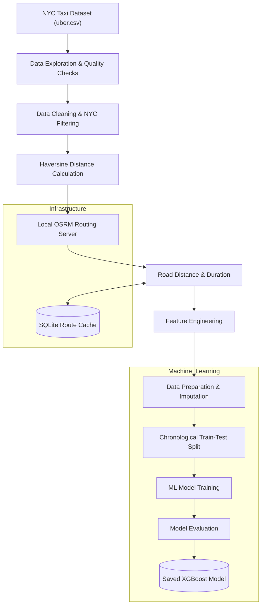
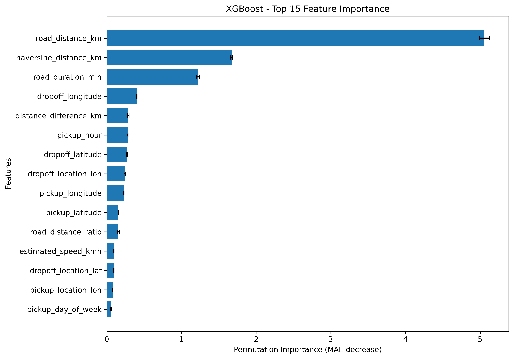
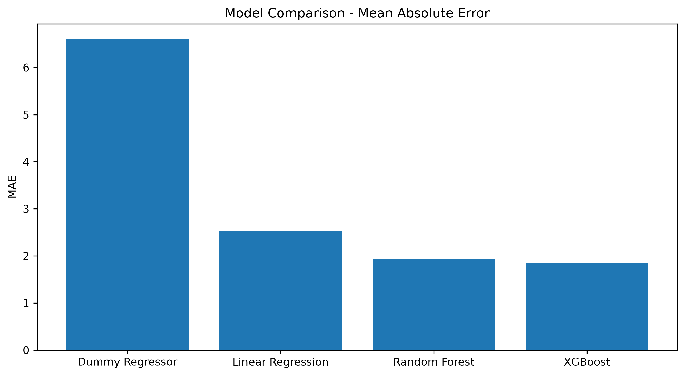
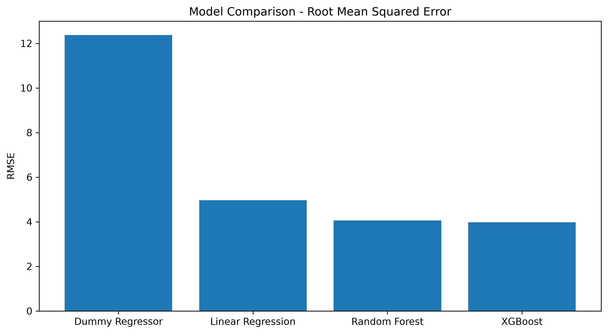
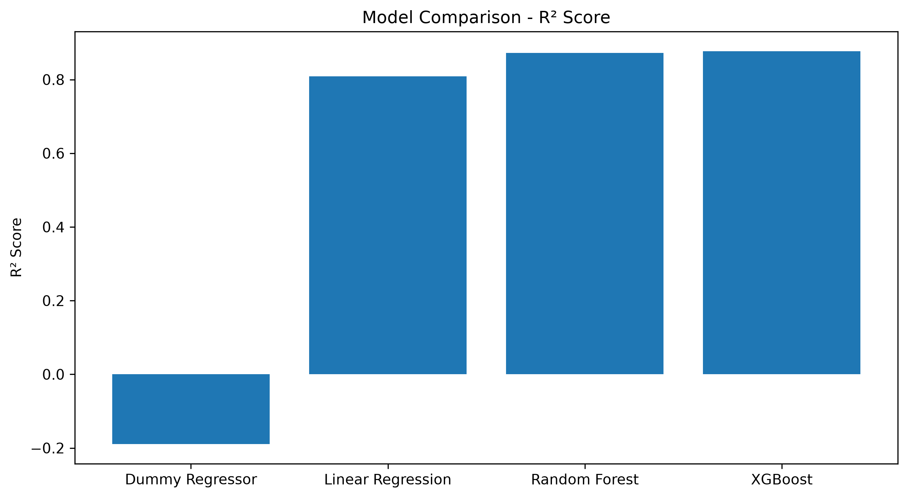

# NYC Taxi Fare Prediction Using Road Network Distance

A machine learning and data engineering project that predicts NYC taxi fares using pickup and dropoff coordinates, road-network distances, estimated travel duration, and time-based features.

The project combines **Python, Pandas, Docker, OSRM, OpenStreetMap, SQLite, and XGBoost** to build an end-to-end data processing and machine learning workflow.

## Project Overview

Traditional distance-based taxi fare prediction often uses straight-line distance (Haversine distance). However, real vehicles travel through road networks, so straight-line distance does not accurately represent road distance.

This project uses a locally hosted **OSRM (Open Source Routing Machine)** server with OpenStreetMap road-network data to calculate estimated road distances and travel durations between pickup and dropoff coordinates.

These features are then used to train and evaluate machine learning models for taxi fare prediction.

## Key Features

- Dataset exploration and data quality checks
- Coordinate validation and NYC geographical filtering
- Haversine distance calculation
- Local OSRM server using Docker
- Road distance and estimated travel duration calculation
- SQLite-based route caching
- Geographical and temporal feature engineering
- Chronological train-test splitting
- Multiple machine learning model comparisons
- Model evaluation and feature importance analysis
- Saved XGBoost model with fitted preprocessing components


## Project Architecture




## Technologies Used

| Category | Technologies |
|---|---|
| Programming Language | Python |
| Data Processing | Pandas, NumPy |
| Machine Learning | Scikit-learn, XGBoost |
| Routing Engine | OSRM |
| Geographical Data | OpenStreetMap |
| Containerization | Docker |
| Database | SQLite |
| Data Storage | Parquet |
| Model Serialization | Joblib |
| Visualization | Matplotlib, Seaborn |
| Development Environment | VS Code, Jupyter Notebook |

## Dataset

The project uses an NYC taxi fare dataset named `uber.csv`.

**Initial dataset:**
- Rows: 200,000
- Columns: 9
- Target variable: `fare_amount`
- Geographical information: Pickup and dropoff latitude and longitude

After geographical filtering and validation, 195,699 records were eligible for the NYC routing workflow.

The dataset contains historical taxi fare records and is used for experimentation and model development.

## Data Engineering Pipeline

### 1. Data Exploration and Cleaning

Performed data quality checks to identify:

- Missing coordinate values
- Invalid geographical coordinates
- Zero-coordinate records
- Trips outside the selected NYC geographical boundaries
- Duplicate records
- Zero and nonpositive fare values

The cleaned NYC dataset was prepared for distance calculation and routing.

### 2. Haversine Distance

Calculated straight-line distances between pickup and dropoff coordinates using the Haversine formula.

This provides a geographical distance baseline for comparison with road-network distances.

### 3. Road Distance Calculation Using OSRM

Set up a local OSRM routing server using:

- Docker
- OSRM backend
- OpenStreetMap NYC road-network extract
- MLD routing algorithm

The routing server calculates estimated driving distance and duration using pickup and dropoff coordinates.

OSRM requests were cached in SQLite to avoid repeated calculations for identical coordinate pairs.

**Routing results:**

| Metric | Result |
|---|---:|
| Total eligible trips | 195,699 |
| Successful routed trips | 195,622 |
| Failed routes | 1 |
| Remaining pending routes | 0 |

The routing results include repeated trips sharing cached route calculations.

### 4. Feature Engineering

Created geographical and temporal features for machine learning.

**Geographical features**
- `haversine_distance_km`
- `road_distance_km`
- `road_duration_min`
- `road_distance_ratio`
- `distance_difference_km`
- `estimated_speed_kmh`
- Pickup and dropoff coordinates

**Temporal features**
- `pickup_hour`
- `pickup_day`
- `pickup_day_of_week`
- `pickup_month`
- `pickup_year`
- `is_weekend`
- `is_rush_hour`

Additional indicators were created to identify missing routing information and unreliable zero-distance OSRM results.

## Machine Learning

### Models Evaluated

Four regression approaches were evaluated:

1. Dummy Regressor — Baseline
2. Linear Regression
3. Random Forest Regressor
4. XGBoost Regressor

The dataset was split chronologically using an 80:20 train-test split to evaluate performance on later records.

Missing numerical values were handled using median imputation fitted only on the training data.

### Model Performance

Evaluation results on the chronological test set:

| Model | MAE | RMSE | R² Score |
|---|---:|---:|---:|
| Dummy Regressor | 6.5982 | 12.3760 | -0.1893 |
| Linear Regression | 2.5220 | 4.9674 | 0.8084 |
| Random Forest | 1.9278 | 4.0618 | 0.8719 |
| **XGBoost** | **1.8502** | **3.9802** | **0.8770** |

**Best-performing model: XGBoost**

- MAE: 1.8502
- RMSE: 3.9802
- R²: 0.8770

XGBoost achieved the best performance among the evaluated models.


### Model Performance Visualizations

**1. Actual vs Predicted Fare**


**2. Feature Importance**



**3. Model Comparison - MAE**



**4. Model Comparison - RMSE**



**5. Model Comparison - R² Score**




## Testing

The project includes an automated test suite built with **pytest** to validate individual components and the end-to-end fare prediction pipeline.

### Run Tests

Activate the virtual environment and execute:

```bash
python -m pytest tests/ -v
```

### Test Coverage

The test suite covers:

- **Distance:** Haversine distance calculations and edge cases.
- **Data Cleaning:** Required columns, missing values, and invalid coordinates.
- **Routing:** OSRM responses, successful routes, and error handling.
- **Feature Engineering:** Temporal features, distance calculations, and missing-value handling.
- **Model:** Model loading, feature validation, and fare predictions.
- **Pipeline:** Successful predictions, unroutable trips, and invalid input validation.

### Test Results

- **Total tests:** 27
- **Passed:** 27
- **Failed:** 0
- **Warnings:** 0

Pipeline tests use mocked OSRM and model responses, so they can run without a live OSRM server.


### Feature Importance

The most influential features according to XGBoost feature importance and permutation importance were:

1. `road_distance_km`
2. `haversine_distance_km`
3. `road_duration_min`

Other useful features included pickup and dropoff coordinates, time-based features, and distance differences.

## Model Evaluation and Limitations

The model performs better on common low- and medium-fare trips.

However, prediction errors increase for unusually expensive trips. The test set contained only 26 trips with fares above $100, and the model tended to underestimate these fares.

Other limitations:

- OSRM estimates routes using a road-network profile; it does not reconstruct the actual historical taxi route.
- Estimated travel duration does not represent historical traffic conditions.
- One route could not be calculated by OSRM.
- Zero-distance routing anomalies were identified and treated as missing routing information.
- The model has not yet undergone complete hyperparameter optimization.
- The additional predictive value of road distance over Haversine distance still needs a dedicated ablation experiment.

## Project Structure

```text
nyc-taxi-road-distance-pipeline/
│
├── data/
│   ├── raw/
│   ├── processed/
│   └── osm/
│
├── models/
│   └── xgboost_taxi_fare_model.joblib
│
├── notebooks/
│   ├── 01_dataset_exploration.ipynb
│   ├── 02_osrm_routing.ipynb
│   └── 03_model_preparation.ipynb
│
├── reports/
│
├── src/
│
├── .gitignore
├── README.md
└── requirements.txt
```

Raw datasets, processed datasets, and OpenStreetMap routing files are excluded from Git tracking.

## Installation and Setup

### Prerequisites

- Python 3.10 or newer
- Docker Desktop
- Git
- OpenStreetMap NYC road-network extract

### 1. Clone the Repository

```bash
git clone https://github.com/SahabajSahaji/nyc-taxi-road-distance-pipeline.git

cd nyc-taxi-road-distance-pipeline
```

### 2. Create a Virtual Environment

```bash
python -m venv .venv
```

Activate it on Windows PowerShell:

```powershell
.venv\Scripts\Activate.ps1
```

### 3. Install Dependencies

```bash
python -m pip install -r requirements.txt
```

### 4. Prepare the Dataset

Place the original `uber.csv` dataset inside:

```text
data/raw/
```

### 5. Prepare the OSRM Routing Server

Place the NYC OpenStreetMap `.osm.pbf` extract inside:

```text
data/osm/
```

Process the road-network data using Docker:

```powershell
docker run --rm -t `
  -v "${PWD}\data\osm:/data" `
  ghcr.io/project-osrm/osrm-backend:latest `
  osrm-extract -p /opt/car.lua /data/nyc-road-network.osm.pbf
```

Partition the road network:

```powershell
docker run --rm -t `
  -v "${PWD}\data\osm:/data" `
  ghcr.io/project-osrm/osrm-backend:latest `
  osrm-partition /data/nyc-road-network.osrm
```

Customize the routing data:

```powershell
docker run --rm -t `
  -v "${PWD}\data\osm:/data" `
  ghcr.io/project-osrm/osrm-backend:latest `
  osrm-customize /data/nyc-road-network.osrm
```

Start the local OSRM server:

```powershell
docker run -d `
  --name osrm-nyc `
  -p 5000:5000 `
  -v "${PWD}\data\osm:/data" `
  ghcr.io/project-osrm/osrm-backend:latest `
  osrm-routed --algorithm mld /data/nyc-road-network.osrm
```

Check the server:

```powershell
docker ps
```

The OSRM API should be available at:

```text
http://localhost:5000
```

### 6. Run the Notebooks

Open the project in VS Code or Jupyter Notebook and execute the notebooks in order:

1. `01_dataset_exploration.ipynb`
2. `02_osrm_routing.ipynb`
3. `03_model_preparation.ipynb`

**Note:** The notebooks contain the project's exploration, routing, feature engineering, and model training workflow. The dataset and OSRM files must be prepared separately because they are not included in the repository.

## Saved Model

The trained XGBoost model is saved at:

```text
models/xgboost_taxi_fare_model.joblib
```

The model bundle contains:

- Trained XGBoost regressor
- Fitted median imputer
- Feature column names and ordering
- Model metadata

The saved bundle does not include the complete feature-engineering pipeline or the OSRM server. Those components must be reproduced separately for new predictions.

## Future Improvements

- Perform an ablation study comparing Haversine-only and road-distance-based models.
- Apply hyperparameter optimization to XGBoost.
- Improve handling of high-fare outliers.
- Develop a reusable Python inference pipeline.
- Build a prediction API using Flask or FastAPI.
- Develop an interactive dashboard using Streamlit.
- Explore cloud deployment using AWS services.
- Add automated data quality checks and pipeline testing.

## Author

**Sahabaj Sahaji**

B.Tech – Computer Science and Engineering (Artificial Intelligence and Machine Learning)

Interested in Data Engineering, Machine Learning, and building practical data-driven applications.

---

*This project was developed as a hands-on exploration of data engineering, geographical routing, feature engineering, and machine learning.*
